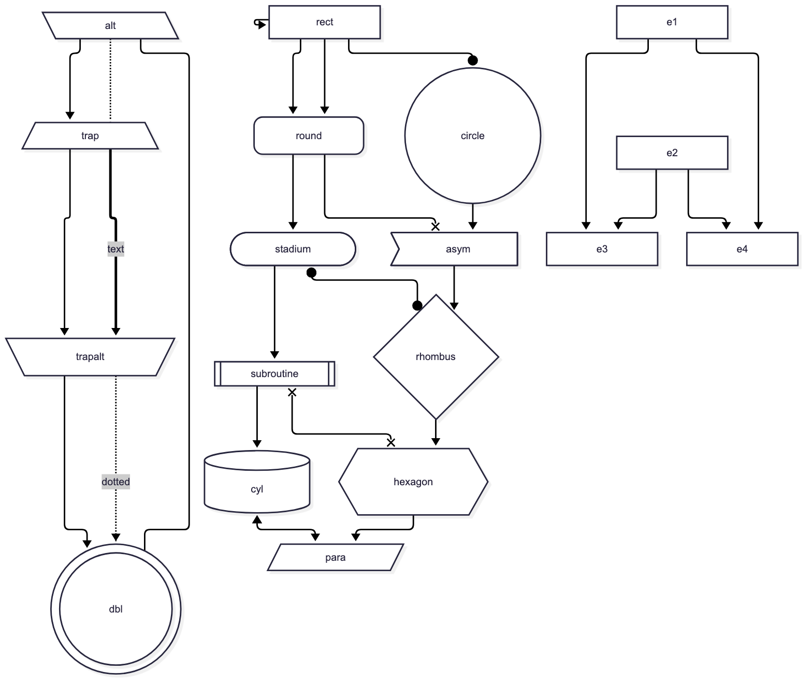
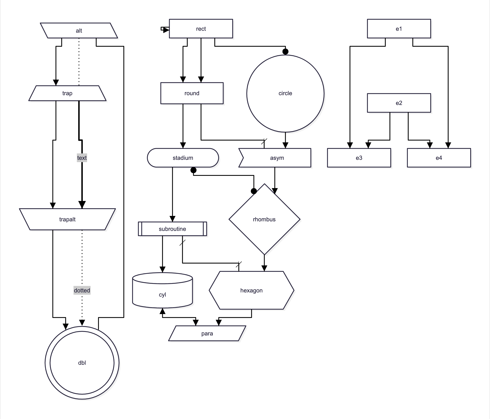

# mmd2vsdx

Convert Mermaid **flowcharts** into editable Microsoft Visio `.vsdx` files that look like Mermaid's own render.

| Mermaid's render | The `.vsdx` (libvisio preview) |
|---|---|
|  |  |

Mermaid computes the layout. mmd2vsdx then rebuilds the drawing as native Visio objects:

| Mermaid | Visio |
|---|---|
| Nodes of any shape: classic syntax and every v11 `@{ shape: … }` shape | Shapes whose outline is Mermaid's geometry, scaled with the shape; fills, strokes, rounding, neo shadow |
| `A@{ icon: "visio:PERIPH/Server" }` | A real Visio stencil master (any of ~9,200 from your own Visio stencil folder), glued and labelled. See [docs/visio-stencils.md](docs/visio-stencils.md) |
| `img@{ img: … }` and `@{ icon: … }` nodes, ``, `fa:fa-…` icons and `$$…$$` KaTeX math inside labels | The picture as a PNG inside the node's group (moves and scales with it); text keeps its place |
| Subgraphs (nested too) | Real Visio **containers**: members move with the frame |
| Edges (incl. `e1@-->` ids, `&` chains, self-loops, subgraph ends) | Visio **Dynamic connectors glued to both shapes** (they follow moved shapes); Mermaid's route (curves traced), rounded bends, solid/dotted/dashed/thick, animated (as dashed), triangle/circle/cross ends |
| Connector routes that would cross a subgraph title, a stencil caption or another edge's label | Re-routed just beside the text (Mermaid itself draws through them); the line stays glued and everything else is Mermaid's route |
| Edge labels | Connector text at Mermaid's position, same background |
| Text, incl. Markdown strings and inline `<span style>` | Chrome's exact line breaks; per-run font, size, colour, bold, italic, underline, strikethrough; same line height |
| `click` links and tooltips | Visio hyperlink and screen tip on the shape |
| Node ids and classes | Shape Data (`Mermaid ID`, `Mermaid classes`) |
| `accTitle` / `accDescr` (or the `title:`) | Document Title and Description properties |
| Looks and layouts: neo, classic, handDrawn; dagre, ELK, swimlane (rotated lane titles); all themes | Whatever Mermaid drew: a node drawn in several stroke colours (e.g. handDrawn hachure) becomes a group, one member per colour |
| `classDef`, `style`, `linkStyle`, themes | Resolved CSS read from Chrome, so styling carries over |
| `title:` front-matter | A text shape |

## Get it

```bash
git clone https://github.com/high-frequensy/mmd2vsdx.git
cd mmd2vsdx
./install.sh
```

## Install on a machine

```bash
./install.sh     # runs setup.sh if needed, links `mmd2vsdx` into ~/.local/bin
```

Then `mmd2vsdx diagram.mmd` works from any directory.

## Setup (once)

```bash
./setup.sh
```

Needs Node 18+, Python 3.9+ and Chrome/Chromium/Edge (or set `CHROME_PATH`; without one, setup downloads Chrome for Testing into `.browser/`).
Everything installs inside this folder, about 40 MB in all: `node_modules/` (puppeteer-core), `vendor/` (pinned Mermaid, KaTeX and font files), `puppeteer.json`, `.venv/`.
Optional: `brew install libvisio` for previews and image tests.

## Use

```bash
./mmd2vsdx.py diagram.mmd                 # -> diagram.vsdx + diagram.png (Mermaid's own render, for comparison)
./mmd2vsdx.py notes.md -o out/            # every ```mermaid block -> out/notes-1.vsdx, notes-2.vsdx, ...
./mmd2vsdx.py a.mmd b.mmd -o out/ --no-png
```

| Option | Meaning |
|---|---|
| `-o, --out` | Output `.vsdx` for a single diagram, or a directory |
| `--no-png` | Don't write Mermaid's reference PNG |
| `--config FILE` | Mermaid config JSON (default `mermaid-config.json`: Arial, which Visio has; Mermaid's default web font is not available in Visio) |
| `--reroute as-needed\|freely\|never` | How Visio may re-route connectors. Default `as-needed` keeps Mermaid's routes until something moves. |
| `--stencils DIR` | Visio stencil library for `visio:` icons (default `stencils/`, not included: copy it from your Visio install, see [docs/visio-stencils.md](docs/visio-stencils.md)) |
| `--find TEXT` | List stencil shapes whose name, stencil or keywords contain TEXT, as `visio:STENCIL/NAME` |
| `--wrap exact\|visio` | `exact` (default) puts Mermaid's line breaks in as hard breaks for a 1:1 look. `visio` keeps only explicit `<br>` breaks so text re-wraps when you resize shapes. |

## Check a file without Visio

```bash
.venv/bin/python validate_vsdx.py drawing.vsdx    # schema + glue/container consistency
./vsdx_preview.py drawing.vsdx                    # PNG of what libvisio (LibreOffice's Visio reader) parses
```

`validate_vsdx.py` checks every part against Microsoft's published Visio 2013 schema (`schema/visio2012.xsd`, from
[Schema map (Visio XML)](https://learn.microsoft.com/en-us/office/client-developer/visio/schema-mapvisio-xml)).
Four documented fixes are applied at load, because the published schema rejects files Visio itself writes; Microsoft's
own template validates clean with them. It also checks that every glue record matches the connector's glue
formula, move trigger and connection point, and that container relationships are reciprocal.

## Tests

```bash
.venv/bin/python tests/run_tests.py            # all cases
.venv/bin/python tests/run_tests.py --update   # accept current output as the new golden files
```

Each `tests/cases/<name>.mmd` is converted and then validated. Its structural snapshot (shapes, text, colours,
label positions, glue, containers) is compared to `tests/golden/<name>.json`, and its libvisio preview to
`tests/golden/<name>.png`. A case can have `<name>.config.json`
(a Mermaid config) and `<name>.args` (extra CLI flags).

Golden PNGs depend on the machine's fonts and Chrome version. On a new machine, run `--update` once, then review.
The JSON snapshots are portable.

## Pinned versions (what was tested)

Mermaid 12.1.0 (pinned in `tools/fetch_assets.py`), puppeteer-core 25.13.0, Chrome 149, libvisio 0.1.11, xmlschema 4.2.0,
Pillow 11.3.0, Python 3.9.6. The converter reads details of Mermaid's SVG
(`data-points`, edge ids, CSS classes), so upgrade Mermaid deliberately and re-run the tests.

## Limits

- **Flowcharts only.** Other diagram types (sequence, class, ER, state, Gantt, …) are rejected with a message.
- **Not yet verified inside Visio itself.** Everything above is checked offline (schema, libvisio). Still to confirm in Visio: thick-edge arrowhead size (Visio scales heads with line weight; one size smaller is used), rounded bends, dash spacing, group nodes, pictures and self-loops.
- **Fixed attach points.** Connector ends are glued to fixed points on shapes (where Mermaid drew them), not to whole shapes.
- **Cross ends.** Visio has no plain "X" arrowhead, so Mermaid cross ends use a slash. Arrowheads take the line's colour.
- **Pictures are bitmaps.** Images and icons are captured from Chrome at 4x as PNG; they are not editable vector art.
- **Callbacks.** `click A callback` (JavaScript functions) has no Visio equivalent and is ignored; URL links are kept.
- **Plain-text labels and wrapping.** With `htmlLabels: false`, Mermaid pre-wraps labels, so `--wrap visio` cannot tell explicit breaks from wrapped ones and keeps all breaks.

## Layout

```
mmd2vsdx.py         converter (stdlib only)
render.cjs          Mermaid -> SVG/PNG in Chrome (puppeteer-core + vendor/)
measure_lines.cjs   asks Chrome how it laid out the SVG: line breaks, label boxes, resolved colours
shot.cjs            rasterises preview SVGs with Chrome
vsdx_preview.py     libvisio-based preview of any .vsdx
validate_vsdx.py    schema + glue/container validator
stencil_lib.py      finds stencil masters and copies them (styles, media, colours) into a .vsdx as instances
tools/fetch_assets.py  downloads the pinned Mermaid, KaTeX and font files into vendor/
tools/stencil_sweep.py  checks every master of the stencil library (import, schema, drawing, scaling)
stencils/1033/      your own copy of Microsoft's Visio stencils (US English); not in git
template/base.vsdx  base document that provides Visio's Dynamic connector master
schema/visio2012.xsd  Microsoft's published Visio schema
mermaid-config.json default Mermaid config (Arial)
tests/              cases, golden files, runner
```

## License and third-party material

mmd2vsdx is MIT licensed ([LICENSE](LICENSE)). It is not affiliated with or endorsed by Microsoft; Visio is a
Microsoft trademark.

- `schema/visio2012.xsd` is Microsoft's published Visio schema, copied unmodified under the permission notice inside
  the file (the patches described above are applied in memory at load).
- Microsoft's Visio stencils are not included. Bring your own from a Visio install; see [docs/visio-stencils.md](docs/visio-stencils.md).
- Runtime dependencies are installed by `setup.sh` from their own sources: [Mermaid](https://github.com/mermaid-js/mermaid) and
  [mermaid-cli](https://github.com/mermaid-js/mermaid-cli)'s font embedder (MIT), puppeteer-core (Apache-2.0), KaTeX (MIT), Font Awesome Free
  (fonts OFL, icons CC BY 4.0), the Open Sans and Recursive fonts (OFL), xmlschema (MIT), Pillow (HPND).
