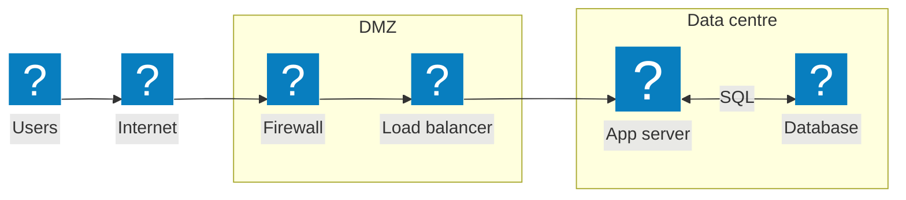

# Mermaid diagrams with real Visio stencil shapes

mmd2vsdx can place shapes from Microsoft's Visio stencils (servers, firewalls, clouds, AWS, Azure, Cisco, racks …)
in a Mermaid flowchart. In the `.vsdx` they are genuine stencil masters: Visio shows the master's name, its own
Shape Data, and you can swap or restyle them like any shape you dragged from the stencil. Connectors stay glued.

mmd2vsdx does **not** ship the stencils: they are Microsoft's, so you bring your own copy from a Visio install
(the US-English library is 363 stencils, about 9,200 shapes, 150 MB).

## 1. Set up (once)

```bash
./setup.sh
```

Then copy the `1033` folder (US English) out of your Visio install into this repo as `stencils/1033/`, or point
mmd2vsdx at it with `--stencils DIR` or the `MMD2VSDX_STENCILS` environment variable. Typical locations:

| System | Folder |
|---|---|
| Windows (Microsoft 365 / 2016+) | `C:\Program Files\Microsoft Office\root\Office16\Visio Content\1033` |
| Windows (32-bit Office) | `C:\Program Files (x86)\Microsoft Office\root\Office16\Visio Content\1033` |

`stencils/` is in `.gitignore`, so your copy is never committed. Without it, diagrams that use `visio:` icons stop
with a message saying so; everything else works.

## 2. Find the shapes you want

```bash
./mmd2vsdx.py --find server          # name, stencil or keyword contains "server"
./mmd2vsdx.py --find "3d"            # works on stencil titles too
```

Each line is the exact name to use, then the stencil's title:

```
visio:PERIPH/Server                       Networks and Peripherals
visio:RCKSVR/Database server              Rack Mounted Servers (US Units)
visio:AWSCOMPUTE/Amazon EC2               AWS Compute
```

Good stencils for architecture and network diagrams:

| Stencil | Look | Examples |
|---|---|---|
| `PERIPH` Networks and Peripherals | 3D | Server, Mainframe, Firewall, Router, Switch, User, Printer |
| `NETLOC` Network Locations | 3D | Cloud, Building, City, House |
| `SERVER` Servers, `RCKSVR` Rack Mounted Servers | 3D | Web server, File server, Database server |
| `NETSYM` Network Symbols | flat | Router, ATM switch |
| `CISCONETWORKSHAPES` Cisco Network Shapes | Cisco icons | 292 shapes |
| `AWS*` (AWSCOMPUTE, AWSDB, AWSNETCONTENTDELIVERY …) | AWS icons | Amazon EC2, Amazon RDS, Amazon CloudFront |
| `AZURE*` (AZURECOMPUTE, AZURENETWORKING …) | Azure icons | Virtual Machine, Azure Firewall Manager |
| `KUBERNETESVISIOSTENCIL` | Kubernetes icons | api, pod, svc |

## 3. Write the Mermaid diagram

A stencil shape is a node with `icon: "visio:STENCIL/NAME"`:



(`tests/cases/stencils_network.mmd`)

- `label` is the caption (plain text, like a shape's own text in Visio; `<b>` and `<br/>` work); `pos: "t"` puts
  it above the shape instead of below.
- The shape keeps the stencil's own size. `h: 60` (or `w: 80`) resizes it in pixels, keeping its proportions.
- Write `visio:NAME` without the stencil when the name is unique. When several stencils have that name, the
  converter prefers a stencil the diagram already uses (so a 3D diagram stays 3D) and says which one it picked.
  Write `STENCIL/NAME` to choose yourself.
- Everything else in the flowchart works as usual: ordinary nodes, subgraphs (they become Visio containers),
  edge labels, `linkStyle`, `classDef` for ordinary nodes.

## 4. Convert

```bash
./mmd2vsdx.py tests/cases/stencils_network.mmd -o out/
```

You get `out/network.vsdx` and `out/network.png`. The PNG is Mermaid's own render; it shows the stencil art too,
so you can check the layout before opening Visio. `.md` files work as well: every ```` ```mermaid ```` block
becomes its own `.vsdx`.

Check a file without Visio:

```bash
.venv/bin/python validate_vsdx.py out/network.vsdx
.venv/bin/python vsdx_preview.py out/network.vsdx      # PNG of what LibreOffice's Visio reader sees
```

## Having an assistant write the diagram

Tell it the syntax and give it the shape names, for example:

> Write a Mermaid flowchart (LR) of our network. Use stencil shapes as nodes with
> `id@{ icon: "visio:STENCIL/NAME", label: "..." }`, from this list:
> visio:PERIPH/User, visio:NETLOC/Cloud, visio:PERIPH/Firewall, visio:PERIPH/Server, visio:PERIPH/Mainframe.
> Put each zone in a subgraph. Label connections with protocol and port.

Paste the output of `./mmd2vsdx.py --find …` into the prompt so it only uses names that exist.

## How it works, and what to know

- Before Mermaid lays the diagram out, each stencil node becomes an image node of the master's exact size,
  drawn from the stencil itself. Mermaid therefore leaves the right space and its PNG shows the real shape.
- In the `.vsdx`, the node *is* an instance of the master, copied into the file with its style sheets and media.
  The Mermaid label replaces the master's own caption (the caption is hidden with Visio's HideText, which you
  can turn off under Format > Behavior).
- Masters that use Office themes keep their own colours; the file applies no theme.
- Every shape in the library is checked automatically: `tools/stencil_sweep.py` imports all of them,
  schema-checks the result, confirms each draws something, and confirms a resized copy scales exactly.
